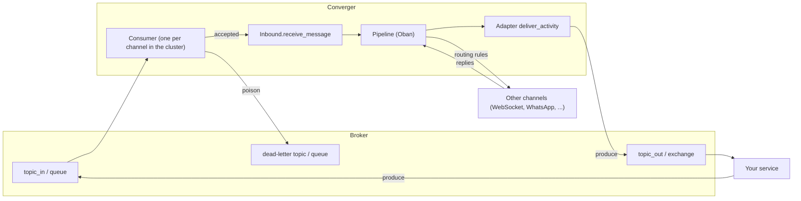

A **broker channel** connects a message broker to Converger as a channel, like a WhatsApp number or a webhook. Backend
integrations (a CRM, an analytics pipeline, a bot runtime) produce messages to a topic or queue, and Converger turns them
into activities; activities the pipeline delivers to the channel are produced to another topic or exchange. The built-in
broker channel types are:

| Type | Broker | Page |
| --- | --- | --- |
| `kafka` | Apache Kafka (and Kafka-compatible brokers such as Redpanda) | [Kafka](kafka.md) |
| `rabbitmq` | RabbitMQ (AMQP 0-9-1) | [RabbitMQ](rabbitmq.md) |
| `mqtt` | MQTT 3.1.1 brokers (Mosquitto, EMQX, HiveMQ, AWS IoT Core, ...) | [MQTT](mqtt.md) |
| `nats` | NATS JetStream | planned ([#42](https://github.com/AimTune/converger/issues/42)) |
| `redis_streams` | Redis Streams with consumer groups | planned ([#42](https://github.com/AimTune/converger/issues/42)) |

The design is recorded in [ADR-0047](../adr/0047-broker-channels-kafka-and-rabbitmq.md); MQTT, and the generalisation of
the consumers that also runs [Discord Gateway](discord.md#gateway-mode) connections, in
[ADR-0055](../adr/0055-mqtt-channel-and-discord-gateway.md).

## Pipeline transport or broker channel?

Kafka and RabbitMQ appear in Converger in two unrelated roles. Pick by what you want to exchange:

| | Pipeline transport | Broker channel |
| --- | --- | --- |
| What it is | The transport of the [Broadway pipeline backend](../architecture/delivery-pipeline.md#broadway): an internal queue between "activity committed" and "deliver to channels" | A channel type (`kafka`, `rabbitmq`) with its own config, modes, deliveries and routing rules |
| Who reads the messages | Converger itself, and only Converger | Your services |
| Message content | `{"activity_id", "channel_id", "channel_type"}`: internal pointers, meaningless outside Converger | The canonical activity JSON plus `tenant_id`, `channel_id` and `conversation_id` |
| Direction | Internal, one way | Inbound (consume `topic_in` / a queue) and outbound (produce to `topic_out` / an exchange) |
| Configured by | The operator, once per deployment (`config :converger, :pipeline`), all tenants share it | Each tenant, per channel, in the admin panel, portal or API |
| Tracking | None of its own (deliveries are tracked per target channel) | Deliveries per activity, retries, circuit breaker, dead letters, health checks |
| Durability | Not durable: pushed after commit ([durability](../architecture/delivery-pipeline.md#durability)) | Outbound: deliveries go through the durable Oban pipeline like every channel. Inbound: at-least-once with idempotent activity creation |

**For integrations, use a broker channel.** The pipeline transport is a throughput option for the delivery machinery and
carries nothing an integration can use; tapping its topic couples you to internal message formats and bypasses
tenancy, routing rules and delivery tracking. A broker channel is a tenant-scoped contract with a documented envelope, and
it composes with everything else: a routing rule can bridge a Kafka channel to an agent console, middleware can transform
what is produced, and replies come back through the same channel.

## How a broker channel works



- **Inbound** (modes `inbound` and `duplex`): a consumer reads `topic_in` (Kafka, MQTT) or `queue` (RabbitMQ) and passes every
  message to `Converger.Inbound.receive_message/3`, the path of every inbound message (webhooks, WebSocket clients). The
  activity is created in a conversation of the channel, or in the conversation named by the message's `conversation_id`,
  and routing rules, middleware and deliveries apply to it as to any other inbound message.
- **Outbound** (modes `outbound` and `duplex`): the pipeline delivers activities to the channel like to any channel
  (Oban jobs, retry policy, circuit breaker, rate limit, dead letters), and the adapter produces the envelope to
  `topic_out` (Kafka, keyed by `conversation_id`) or publishes it to `exchange` with `routing_key` (RabbitMQ, with
  publisher confirms), or publishes it with QoS 1 to the conversation's `topic_out` (MQTT, waiting for the `PUBACK`). A delivery is `sent` once the broker has acknowledged the message.
- **No echo:** a message consumed from a channel is not produced back to the same channel, although the channel is the
  primary channel of the conversation it created. Replies in the conversation (an agent's, a bot's) are.

Broker channels do not accept the inbound webhook: a `POST /api/v1/channels/:id/inbound` is rejected.

## Envelope

Both directions use the same JSON object: the canonical activity
([`Serializer.canonical/1`](https://github.com/AimTune/converger/blob/main/lib/converger/activities/serializer.ex), the
body of outbound webhooks and WebSocket frames) plus the channel.

### Outbound

```json
{
  "event": "activity.created",
  "channel_id": "3f0c6e8e-5a51-4f38-9d6c-2f3e2f8c1a10",
  "tenant_id": "b1f0e3c4-8f5e-4d39-a6a1-0c6a3a1d2b7e",
  "conversation_id": "8d192c0e-64b6-4ffb-9541-54f740780cd0",
  "id": "c2b1b7f6-7d43-4e2c-9b8f-6c7d1e2a3b4c",
  "type": "message",
  "sender": "agent-7",
  "text": "It ships today",
  "attachments": [],
  "metadata": {},
  "seq": 2,
  "reply_to_id": null,
  "idempotency_key": null,
  "edited_at": null,
  "deleted_at": null,
  "inserted_at": "2026-10-12T09:00:00.000000Z"
}
```

Every activity type the pipeline delivers is produced as is (broker channels render every type natively), including
conversation lifecycle events (`conversationUpdate` on close and reopen). The activity `id` is stable across delivery
retries: a consumer that must not process a message twice deduplicates on it (a retried produce can write the same
activity twice).

### Inbound

The same object. Only these keys are read; everything else (`id`, `seq`, `inserted_at`, `event`, ...) is ignored, so an
outbound envelope can be fed back unchanged:

| Key | Required | Meaning |
| --- | --- | --- |
| `type` | no | Activity type, default `message`. |
| `text`, `attachments`, `metadata`, `reply_to_id` | no | Activity client fields ([activities](../concepts/activities.md)). A `message` needs text or attachments. |
| `sender` | no | Stored as `activity.sender`. Default: the participant's `external_id`, else `external`. |
| `conversation_id` | no | Write into this conversation (any conversation of the channel's tenant, for example a web chat conversation a bot answers). Without it the message joins the participant's open conversation on the channel, or starts a new one. |
| `participant` | no | `{"external_id": "cust-1", "display_name": "Ada"}`: messages of one external party share their open conversation, as on the [inbound webhook](overview.md#parse_inbound2). |
| `idempotency_key` | no | Your own message id. When absent, the broker message id is used (below). |
| `tenant_id`, `channel_id` | no | When present they must be the consuming channel's; a mismatch is a poison message. Use them to catch messages produced to the wrong topic. |

The activity's `metadata.converger_broker` is set by Converger to `{"channel_id", "message_id", "source"}` (the
consuming channel, the broker message id and where it was read from); a value sent by the producer is replaced.

Example, produced to `topic_in` by an external script:

```bash
echo 'cust-1:{"text":"Where is my order?","participant":{"external_id":"cust-1"}}' |
  kafka-console-producer.sh --bootstrap-server kafka:9092 --topic crm.in \
    --property parse.key=true --property key.separator=:
```

## Delivery guarantees and idempotency

Inbound processing is **at-least-once with idempotent activity creation**:

1. A message is acknowledged (Kafka: its offset committed; RabbitMQ: `basic.ack`; MQTT: `PUBACK`) only after it was accepted or written
   to the dead-letter destination. A crash or a restart before that redelivers it.
2. Every message gets an idempotency key: the envelope's `idempotency_key`, else `<type>:<broker message id>`:

   | Type | Broker message id | Example key |
   | --- | --- | --- |
   | `kafka` | `topic/partition/offset` | `kafka:crm.in/2/41` |
   | `rabbitmq` | the AMQP `message_id` property | `rabbitmq:9b1c...` |
   | `mqtt` | none (packet ids are reused): the SHA-256 of topic and payload, see [MQTT idempotency](mqtt.md#idempotency) | `mqtt:5e2a...` |

3. A redelivered message carries the same key and is recognised as a duplicate: no second activity, no second delivery
   (`converger.inbound.received.count` with `outcome: duplicate`).

Consumers therefore resume from the committed offset after a restart, and a replay (a reset consumer group, a message
redelivered by RabbitMQ) never duplicates activities. A RabbitMQ message without `message_id` and without
`idempotency_key` has no stable id: it is accepted again when it is redelivered, so set `message_id` when publishing.
The Kafka offset-based key does not recognise a message a producer wrote twice (a producer retry gets a new offset):
send an `idempotency_key` to cover that.

## Poison messages and retries

| Failure | Examples | Handling |
| --- | --- | --- |
| Poison: the message can never be accepted | invalid JSON, not an object, a `message` without text or attachments, a malformed `conversation_id`, a `tenant_id` / `channel_id` mismatch, an unknown or closed conversation, an activity the schema rejects (unknown `type`, text too long) | Written to the channel's dead-letter destination at once, then acknowledged |
| Transient | database unavailable, an exception | Retried in place with exponential backoff (0.5 s doubling, at most 30 s between attempts), 8 attempts by default; then dead-lettered with `failed after N attempts, last error: ...` |

The dead-letter destination is per channel:

| Type | Destination (default) | What is written |
| --- | --- | --- |
| `kafka` | topic `dlq_topic` (`<topic_in>.dlq`) | the original key, value and headers, plus `x-converger-error`, `x-converger-source` (`topic/partition/offset`) and `x-converger-channel-id` |
| `rabbitmq` | queue `dlq_queue` (`<queue>.dlq`), through the default exchange | the original body, `message_id` and headers, plus the same `x-converger-*` headers; published persistent, with confirms and `mandatory` |
| `mqtt` | topic `topic_dlq` (`converger/dlq/{channel_id}`) | a JSON object with `error`, `source` (the topic), `channel_id`, `message_id` and the original `payload` (MQTT 3.1.1 has no headers), QoS 1 |

Writing to the dead-letter destination is retried (same backoff, at most 30 s between attempts) until it succeeds, and
only then is the message acknowledged, so a message is never dropped. While the dead-letter destination is unavailable
the consumer stalls on that message (Kafka: that partition) and logs `Broker dead-letter write failed, retrying`.
Create the dead-letter topic or queue before you create the channel (RabbitMQ: or set `declare: true`), or the consumer
stalls on the first poison message. To replay dead letters, fix the cause and produce them back to `topic_in` / the
queue (`kafka-console-consumer` piped to `kafka-console-producer`, the RabbitMQ shovel or management UI "move
messages"); their idempotency key changes with the new offset unless the envelope carries an `idempotency_key`.

Ordering: Kafka messages of one partition are processed in order (offsets are committed in order); a message waiting
for retries holds back the rest of its partition. Outbound, the activities of a conversation are produced to one
partition (keyed by `conversation_id`) in the order the pipeline delivers them. RabbitMQ consumers default to
`concurrency: 1`, which keeps the queue order.

## Consumers in a cluster

`Converger.Channels.Consumers` (a `DynamicSupervisor`) runs **one consumer per channel in the cluster**, for every
active channel of a broker type in mode `inbound` or `duplex` (and every `discord` channel with `gateway: true`, whose
Gateway connection is run the same way). A consumer is a Broadway pipeline (Kafka, RabbitMQ) or the process the adapter
names (`consumer_child_spec/1`: the MQTT subscriber, the Discord Gateway connection):

- **Exactly one.** Each consumer (`Converger.Channels.Broker.Consumer`) is registered with `:global` under
  `{Converger.Channels.Broker.Consumer, channel_id}`; a second start on any node is refused. If a network partition
  lets two nodes start one each, `:global` keeps one and stops the other when the partition heals.
- **Spread over nodes.** A channel's consumer is started by the node that owns it: the highest
  `:erlang.phash2({node, channel_id})` among the connected nodes (rendezvous hashing). If the owner does not start it,
  any node does on the next reconciliation.
- **Follows the channels.** Creating, updating, enabling, disabling or deleting a channel notifies the consumer
  manager of every node over PubSub (`Converger.Channels.Consumers.Manager`): the consumer is started, restarted
  (when its config, mode or status changed) or stopped at once. A full reconciliation also runs every 30 s
  (`BROKER_RECONCILE_INTERVAL_MS`) and when a node joins or leaves, which moves the consumers of a stopped node to the
  others and restarts consumers that gave up.
- **Broker outages.** A consumer that cannot reach its broker crashes and is restarted up to 3 times a minute; then it
  stops, and the next reconciliation starts it again, so a broken channel is retried every 30 s without affecting other
  channels.
- **Shutdown.** On a graceful stop the consumers drain (in-flight messages are finished and acknowledged) before the
  HTTP endpoint stops.
- **Opting nodes out.** `BROKER_CONSUMERS=false` keeps consumers off a node (for example web-only nodes); the other nodes
  run them. A consumer that runs on another node is unaffected.

Producing does not need a cluster-wide singleton: each node keeps one producer connection per broker channel
(`Converger.Channels.Broker.Publishers`), opened on the first delivery, replaced when the channel's config changes and
closed after 15 minutes without deliveries.

Kafka consumer groups are per channel (`group_id`, default `converger-<channel id>`): because the consumer is a
singleton, the group has one member, which reads every partition.

## Operations

| Signal | Meaning |
| --- | --- |
| log `Broker consumer started` / `stopped` / `could not start` | consumer lifecycle, with `channel_id` and the reason |
| log `Broker message dead-lettered` | a poison message or exhausted retries, with `source` and `reason` |
| log `Broker message failed, retrying` | a transient failure, with the attempt |
| log `Broker dead-letter write failed, retrying` | the consumer is stalled on the dead-letter destination |
| `converger.broker.dead_lettered.count` (tags `channel_type`, `reason`) | dead-lettered messages, `reason` is `poison` or `retries_exhausted` |
| `converger.broker.retry.count` (tag `channel_type`) | in-place retries |
| `converger.inbound.received.count` (tags `channel_type`, `outcome`) | accepted (`created`), `duplicate`, `rejected` messages, as for webhooks |
| `broadway_*` metrics with `topology_name="converger_consumer_<channel id>"` | Broadway processor metrics of a consumer |

`Converger.Channels.Consumers.node_of(channel_id)` (from a remote console) tells where a channel's consumer runs. Health
checks work as for other external channels: the delivery failure rate, and for idle channels a broker probe (Kafka
metadata for the topics, a RabbitMQ connection).

Configuration: [configuration](../operations/configuration.md#broker-channels).

## Security

- The whole channel `config` (including `sasl_password` / `password`) is encrypted at rest and redacted in audit logs
  ([ADR-0012](../adr/0012-secrets-at-rest-and-audit-redaction.md)); keys ending in `_password` are redacted like
  `_secret` and `_token`.
- Broker hosts a tenant configures go through the same SSRF guard as webhook URLs
  ([`UrlGuard`](https://github.com/AimTune/converger/blob/main/lib/converger/channels/url_guard.ex)): private, loopback
  and link-local addresses are rejected when the channel is saved and again when a connection is opened. Brokers usually
  run on a private network: allow them with `WEBHOOK_ALLOWED_TARGETS` (host names or CIDR ranges, for example
  `kafka-*.internal,10.20.0.0/16`). The guard checks the configured bootstrap hosts; Kafka clients then connect to the
  addresses the cluster advertises.
- Use TLS (`tls: true` for Kafka and MQTT, an `amqps://` URL for RabbitMQ) and SASL or broker credentials with access limited to
  the channel's topics or queues.
- A message on `topic_in` is trusted like a signed inbound webhook: anyone who can produce to it can write into the
  tenant's conversations (`conversation_id` is checked against the channel's tenant only). Restrict producer ACLs.

## Platform notes

The Kafka client computes record checksums (CRC32C) with a NIF (`crc32cer`) that is built with `cmake` and is not built
on Windows. Kafka channels work on Linux and macOS (the Docker image installs `cmake` in its build stage); on a Windows
development machine, run Converger, or at least the Kafka tests, in a container or WSL. RabbitMQ channels work
everywhere.

## Running the broker tests

Unit tests (config, envelope, idempotency, dead-lettering, consumer lifecycle) run with `mix test` and need no broker.
The end-to-end suites run against real brokers and are excluded by default (tags `:kafka`, `:rabbitmq` and `:mqtt`). They check
that a message produced to `topic_in` reaches a WebSocket client through a routing rule, that the WebSocket reply is
produced to `topic_out`, that a restarted consumer resumes from its committed offsets without duplicates, and that
poison messages reach the dead-letter destination.

```bash
docker run -d --name kafka -p 9092:9092 apache/kafka:3.9.1
docker run -d --name rabbitmq -p 5672:5672 rabbitmq:3.13-management

KAFKA_BROKERS=localhost:9092 mix test --only kafka
RABBITMQ_URL=amqp://localhost:5672 mix test --only rabbitmq   # RABBITMQ_USERNAME / RABBITMQ_PASSWORD, default guest
```

The MQTT suite: see [running the MQTT tests](mqtt.md#running-the-mqtt-tests).

```bash
docker run -d --name mosquitto -p 1883:1883 eclipse-mosquitto:2 mosquitto -c /mosquitto-no-auth.conf
MQTT_HOST=localhost MQTT_PORT=1883 mix test --only mqtt
```

The suites create uniquely named topics and queues and allow private broker addresses for their duration. CI runs them
in the optional "Broker channel suites" job (`.github/workflows/ci.yml`).

## Related

- [Kafka](kafka.md), [RabbitMQ](rabbitmq.md), [MQTT](mqtt.md)
- [Channels and adapters](overview.md), [Routing rules](../concepts/routing-rules.md)
- [Delivery pipeline](../architecture/delivery-pipeline.md) (the pipeline transport)
- [ADR-0047](../adr/0047-broker-channels-kafka-and-rabbitmq.md)
