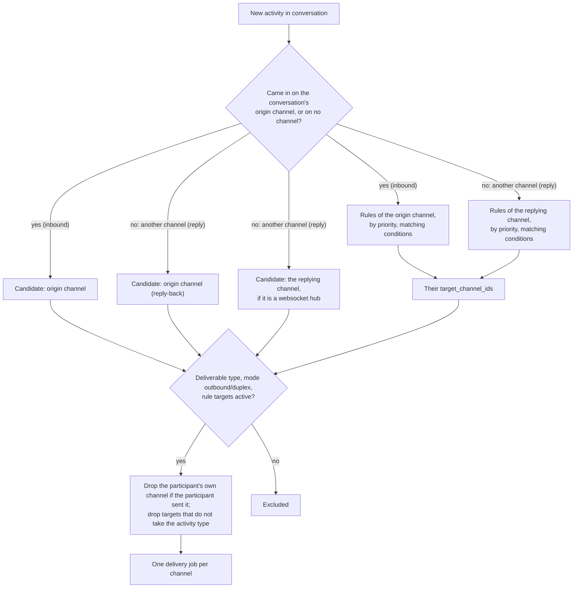

A routing rule says: "an activity in a conversation on channel **A** that matches these conditions is also delivered to
channels **B**, **C**, ...". Rules are how Converger bridges channels. For example, they forward WhatsApp messages to an
agent console, and VIP messages to a priority webhook. Without a rule, an activity goes only to the conversation's own
channel, and only if that channel can send.

Source: [`lib/converger/routing_rules/routing_rule.ex`](https://github.com/AimTune/converger/blob/main/lib/converger/routing_rules/routing_rule.ex),
[`lib/converger/routing_rules/conditions.ex`](https://github.com/AimTune/converger/blob/main/lib/converger/routing_rules/conditions.ex),
[`lib/converger/routing_rules.ex`](https://github.com/AimTune/converger/blob/main/lib/converger/routing_rules.ex) (`route/3`),
[`Converger.Pipeline.plan/2`](https://github.com/AimTune/converger/blob/main/lib/converger/pipeline.ex),
[`lib/converger/routing_rules/dry_run.ex`](https://github.com/AimTune/converger/blob/main/lib/converger/routing_rules/dry_run.ex).
Design: [ADR-0046](../adr/0046-conditional-routing-rules-and-reply-back-routing.md).

## Schema

Table `routing_rules`:

| Field | Type | Default | Notes |
| --- | --- | --- | --- |
| `id` | uuid | | Primary key. |
| `tenant_id` | uuid | | Owner. `(tenant_id, name)` is unique. |
| `name` | text | | Required. |
| `source_channel_id` | uuid | | Required. Deleting the channel deletes its rules. |
| `target_channel_ids` | uuid array | `[]` | Required, 1 to 20 entries. |
| `enabled` | boolean | `true` | Disabled rules are ignored for delivery and for cycle detection. |
| `conditions` | jsonb | `{}` | When the rule applies, see [Conditions](#conditions). `{}` matches every activity. |
| `transformations` | jsonb array | `[]` | Middleware chain for this rule's targets, see [Per-rule transformations](#per-rule-transformations). |
| `priority` | integer | `100` | Evaluation order among the source channel's rules, lowest first (-1,000,000 to 1,000,000). |
| `stop_processing` | boolean | `false` | When this rule matches, later rules are not evaluated. |
| `inserted_at`, `updated_at` | utc_datetime | | |

Rules created before conditional routing have the defaults, so they keep matching every activity.

## Validation

`create_routing_rule/2` and `update_routing_rule/3` enforce:

| Rule | Error (on `target_channel_ids` unless noted) |
| --- | --- |
| 1 to 20 targets | `should have at least 1 item(s)` / `should have at most 20 item(s)` |
| The source is not among the targets | `cannot include the source channel` |
| The source and all targets belong to the rule's tenant | `all channels must belong to the same tenant` |
| The source can receive (`inbound` or `duplex`) | on `source_channel_id`: `source channel is outbound-only and cannot receive inbound messages` |
| No target is `inbound`-only | `these target channels are inbound-only and cannot deliver outbound: <names>` |
| No cycle among the tenant's enabled rules | `would create a routing cycle` |
| Unique name per tenant | on `tenant_id`: `has already been taken` (Ecto reports a composite unique constraint on its first field) |
| Valid conditions (see [limits](#limits)) | on `conditions`, for example `conditions.all[0]: unknown op "like" (use eq, neq, in, contains, regex, exists, gt, lt)` or `conditions: regex does not compile: "(a"` |
| Valid transformations | on `transformations`: `unknown middleware type: foo`, `add_prefix: requires "prefix" (string)` |
| Priority in range | on `priority`: `must be less than or equal to 1000000` |

Cycle detection (`would_create_cycle?/4`) builds the graph of the tenant's enabled rules, excluding the rule being
updated, adds the proposed edges, and runs a breadth-first search from each target to see whether it leads back to the
source. **Conditional edges count as edges**: a rule whose conditions rarely match can still carry an activity, so the
check is conservative and ignores conditions. Toggling a rule on with `toggle_routing_rule/2` re-checks tenant isolation
and cycles.

## Conditions

`conditions` is a JSON object:

- `{}` matches every activity (the default);
- a predicate: `{"field": "metadata.vip", "op": "eq", "value": true}`;
- a group: `{"all": [...]}` (AND), `{"any": [...]}` (OR), `{"not": <condition>}`.

A JSON **list** given as the whole condition is shorthand for `{"all": [...]}` and is stored in that form.

```json
{
  "all": [
    {"field": "type", "op": "eq", "value": "message"},
    {"any": [
      {"field": "metadata.vip", "op": "eq", "value": true},
      {"field": "conversation.metadata.department", "op": "in", "value": ["sales", "billing"]}
    ]},
    {"field": "time.hour", "op": "gt", "value": 8, "utc_offset_minutes": 180},
    {"field": "time.hour", "op": "lt", "value": 18, "utc_offset_minutes": 180}
  ]
}
```

### Fields

| Field | Value |
| --- | --- |
| `type`, `sender`, `text` | The activity's. |
| `metadata.<path>` | A key of the activity's metadata. Dots go deeper: `metadata.order.total`. |
| `conversation.metadata.<path>`, `conversation.status` | The conversation's. |
| `participant.external_id`, `participant.display_name`, `participant.metadata.<path>` | The conversation's [participant](participants.md) (the WhatsApp number, email address, ...), if it has one. |
| `time.hour`, `time.minute`, `time.minute_of_day`, `time.weekday`, `time.date` | The activity's `inserted_at`, in UTC unless the predicate has `utc_offset_minutes` (-720 to 840). `weekday` is 1 (Monday) to 7 (Sunday), `minute_of_day` 0 to 1439, `date` `YYYY-MM-DD`. |

Time conditions use the time the activity was stored, not the time a delivery runs, so a retry hours later is routed
the same way. Fixed offsets only: there is no time zone database, so daylight saving time is not applied.

### Operators

| `op` | `value` | True when |
| --- | --- | --- |
| `eq` / `neq` | any JSON value | the field equals / does not equal it (`1` equals `1.0`) |
| `in` | list (at most 100) | the field equals one of them; a list field matches when any element does |
| `contains` | any | a string field contains it as a substring; a list field has it as an element; an object field has it as a key |
| `regex` | string (at most 256 bytes) | a string field matches the regex (PCRE, Unicode) |
| `exists` | `true` (default) or `false` | the field is present and not `null` (or is missing) |
| `gt` / `lt` | number or string | the field is a value of the same kind, greater / less (strings compare byte-wise, so ISO dates work) |

A missing field equals nothing: `eq`, `in`, `contains`, `regex`, `gt` and `lt` are false and `neq` is true. Matching
is case-sensitive; use `(?i)` in a regex for case-insensitive matching.

### Limits

Conditions are validated when the rule is saved. At most 32 predicates, nesting depth 4, field paths of 8 segments,
100 values per `in`, and only the keys `field`, `op`, `value` and `utc_offset_minutes` in a predicate. A regex must
compile when the rule is saved and is at most 256 bytes; it runs with a PCRE match limit, so a pattern with
catastrophic backtracking stops and counts as "no match" instead of blocking a delivery worker.

## Priority and stop_processing

The enabled rules of a source channel are evaluated in ascending `priority`, then by `name`, then by `id`. Every
matching rule contributes its targets. A **matching** rule with `stop_processing: true` ends the evaluation (first-match
semantics): the rules after it are not evaluated (the dry-run reports them as `skipped`). A non-matching rule never
stops anything.

For "VIP messages only to the priority webhook, everything else to the normal queue", give the VIP rule
`priority: 10, stop_processing: true` and the catch-all rule the default `priority: 100`.

## How activities fan out

Routing is resolved per activity, when it is created, inside the transaction that enqueues its delivery jobs
(`Converger.Pipeline.plan/2`). It depends on where the activity came from:



The details that matter:

- **The origin.** Every conversation records the channel it started on (`conversations.origin_channel_id`, see
  [Conversations](conversations.md#channels-of-a-conversation)) and the channel each activity came in on
  (`activities.source_channel_id`).
- **Inbound direction.** An activity that came in on the origin channel, or on no channel at all (posted with the
  tenant API, a lifecycle event, an activity stored before conditional routing) is routed as before: to the origin
  channel and to the targets of the origin channel's matching rules.
- **Reply-back.** An activity that came in on **another** channel (an agent answering on a `websocket` console that a
  rule routed the conversation to, a Slack thread, an email reply that joined the conversation) goes back to the
  origin channel, where the conversation's participant is, and **not** to the origin channel's other rule targets.
  Only the rules of the replying channel are evaluated, so a rule from that channel can add targets ("unless a rule
  says otherwise"), for example to copy agent replies to an audit webhook. A replying `websocket` channel also gets a
  delivery itself: it is a hub of many sockets (other agents' consoles see the reply), and the sending socket drops its
  own frame by `seq`.
- **One hop.** Only the rules of one channel apply to an activity. A target channel's own rules are not followed for
  the same activity. Routing is not transitive, and cycle detection is a safety net for rule edits.
- **Deliverable types** are those whose adapter has the `:outbound` capability. A `websocket` target gets a delivery
  like any other: its adapter pushes the activity, after the target's middleware and the matched rules'
  transformations, to the target channel's sockets that follow the whole channel (`converger:channel:<id>`, an agent
  console) or that joined the conversation. A socket of a `websocket` channel may join `converger:conversation:<id>`
  of a conversation on another channel when an enabled rule routes that channel to it, whatever the rule's conditions
  ([Client API](../api/client-api.md), [ADR-0033](../adr/0033-websocket-channel-adapter-delivery.md)). Conditions
  decide deliveries, not access: such a socket's replay contains the whole conversation.
- **No echo to the author.** When the activity's `sender` is the conversation participant's `external_id`, the
  participant's own channel is dropped, so a WhatsApp user does not get their own message back. A rule target on which
  the sender is a participant is dropped too (an email reply in a web chat conversation is not mailed back to its
  author). A `websocket` channel is never dropped by this rule.
- **Lifecycle events** (`conversationUpdate` from close and reopen) go only to adapters with the `:lifecycle_events`
  capability (`webhook`, `websocket`). They are routed like any other activity, so a rule with a `type` condition can
  exclude them.
- Each target gets its own [delivery](deliveries.md), its own retries, and its own middleware: the target channel's
  `transformations`, then the matched rules' ones.

Every channel a conversation is routed to or written from is recorded in `conversation_channels`
([Conversations](conversations.md#channels-of-a-conversation)).

### Example

A tenant has a `whatsapp_meta` channel `wa-support` (duplex), a `websocket` channel `agent-console` and two `webhook`
channels, `crm` and `vip-alerts`. Rules of `wa-support`:

| Rule | Priority | Conditions | Targets | Transformations |
| --- | --- | --- | --- | --- |
| `vip` | 10 | `{"field": "metadata.vip", "op": "eq", "value": true}` | `vip-alerts` | `add_prefix "[VIP] "` |
| `to-console` | 100 | `{}` | `agent-console`, `crm` | |

| Activity in a `wa-support` conversation | Delivered to |
| --- | --- |
| Inbound message from the WhatsApp user, `metadata.vip` true | `vip-alerts` (`[VIP] ...`), `agent-console`, `crm` (`wa-support` is dropped: the participant is the sender) |
| Inbound message without `vip` | `agent-console`, `crm` |
| Agent reply sent on `agent-console` | `wa-support` (to the participant's number) and `agent-console` (the hub); **not** `crm` or `vip-alerts` |
| Agent reply posted with `POST /api/v1/conversations/:id/activities` (no channel) | `wa-support`, `agent-console`, `crm` (inbound direction, as before) |
| Conversation closed | `agent-console`, `crm` (lifecycle event, webhook and websocket only) |

To copy agent replies to `crm` as well, add a rule with source `agent-console` and target `crm`.

## Per-rule transformations

`transformations` uses the same format as a channel's [middleware](middleware.md) chain, for example
`[{"type": "add_prefix", "prefix": "[VIP] "}]`, and is validated the same way. When an activity is delivered to a
target, the target channel's own chain runs first, then the chains of the matched rules that list this target, in rule
order. Other targets of the same activity are not affected. A halt in a rule's chain dead-letters that delivery only,
like a channel middleware halt.

The rules are re-evaluated when the delivery runs (the time conditions use the activity's time, so the result is the
same), so editing a rule's transformations affects deliveries that have not run yet, as editing a channel's
transformations does. The routed sockets of a `websocket` channel receive the same transformed activity, live and on
replay.

## Dry-run

The dry-run shows what the pipeline would do with an activity, without storing or sending anything. It runs the same
planning and transformation code as a real delivery (`Converger.RoutingRules.DryRun`), and reports:

- the routing direction (`inbound` or `reply`), the origin channel, the channel the activity arrives on and whose rules
  were evaluated;
- every evaluated rule with its result: `matched`, `not_matched` or `skipped` (after a `stop_processing` match);
- every candidate channel: why it is a candidate (`origin`, `reply_back`, `source_hub`, `rule` with the rule ids), and
  either the payload it would receive (after the type downgrade, its middleware and the rules' transformations), a
  middleware halt, or why it is excluded (`echo`, `inactive`, `inbound_only`, `not_deliverable`,
  `unsupported_activity`).

Use it from the admin panel (**Routing Rules, Dry run an activity**, `/admin/routing_rules/dry_run`) or the tenant API
(`POST /api/v1/routing_rules/dry_run`, [reference](../api/tenant-api.md#dry-run-routing)).

## Managing rules

| Where | How |
| --- | --- |
| Admin panel | **Admin, Routing Rules** (`/admin/routing_rules`): create and edit rules, including priority, stop processing, conditions and transformations (JSON); dry-run page at `/admin/routing_rules/dry_run` |
| Tenant portal | `/portal/routing_rules`: lists rules with their priority and conditions; roles `owner`, `admin`, `member` can enable and disable them |
| Tenant API (`x-api-key`) | `/api/v1/routing_rules` |

Tenant API endpoints:

| Method and path | Body | Success |
| --- | --- | --- |
| `GET /api/v1/routing_rules` | | `200 {"data": [rule, ...]}` |
| `GET /api/v1/routing_rules/:id` | | `200 {"data": rule}` |
| `POST /api/v1/routing_rules` | `{"routing_rule": {"name", "source_channel_id", "target_channel_ids", "enabled", "conditions", "transformations", "priority", "stop_processing"}}` | `201 {"data": rule}` |
| `PATCH` or `PUT /api/v1/routing_rules/:id` | `{"routing_rule": {...changed fields}}` | `200 {"data": rule}` |
| `DELETE /api/v1/routing_rules/:id` | | `204` |
| `POST /api/v1/routing_rules/dry_run` | `{"source_channel_id", "activity", ...}` | `200 {"data": result}` |

```bash
curl -s -X POST http://localhost:4000/api/v1/routing_rules \
  -H "x-api-key: $API_KEY" -H "content-type: application/json" \
  -d '{"routing_rule": {"name": "vip", "source_channel_id": "8d1e...", "target_channel_ids": ["4b7c..."],
       "conditions": [{"field": "metadata.vip", "op": "eq", "value": true}],
       "transformations": [{"type": "add_prefix", "prefix": "[VIP] "}],
       "priority": 10, "stop_processing": true}}'
```

```json
{
  "data": {
    "id": "e2a9...",
    "name": "vip",
    "source_channel_id": "8d1e...",
    "target_channel_ids": ["4b7c..."],
    "enabled": true,
    "conditions": {"all": [{"field": "metadata.vip", "op": "eq", "value": true}]},
    "transformations": [{"type": "add_prefix", "prefix": "[VIP] "}],
    "priority": 10,
    "stop_processing": true,
    "tenant_id": "3f2a...",
    "inserted_at": "2026-10-12T10:30:00Z",
    "updated_at": "2026-10-12T10:30:00Z"
  }
}
```

`tenant_id` always comes from the API key. Validation errors return
`422` `validation_failed` with `details` `{"target_channel_ids": ["would create a routing cycle"]}` ([errors](../api/errors.md)). Rule changes made through the API are
audit-logged with actor type `tenant_api`.
